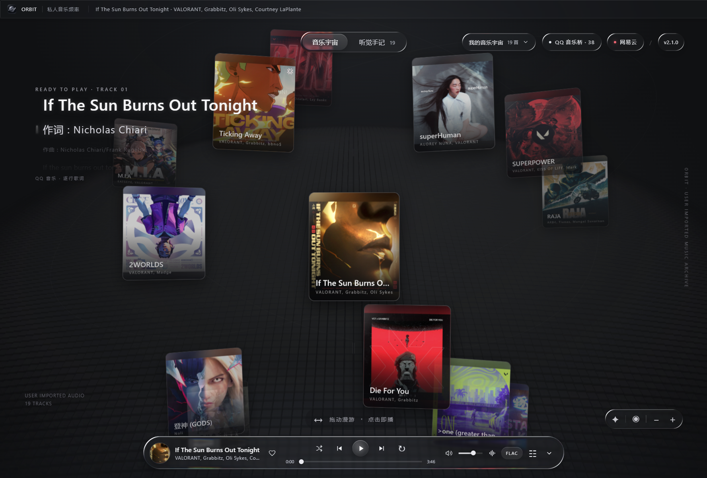
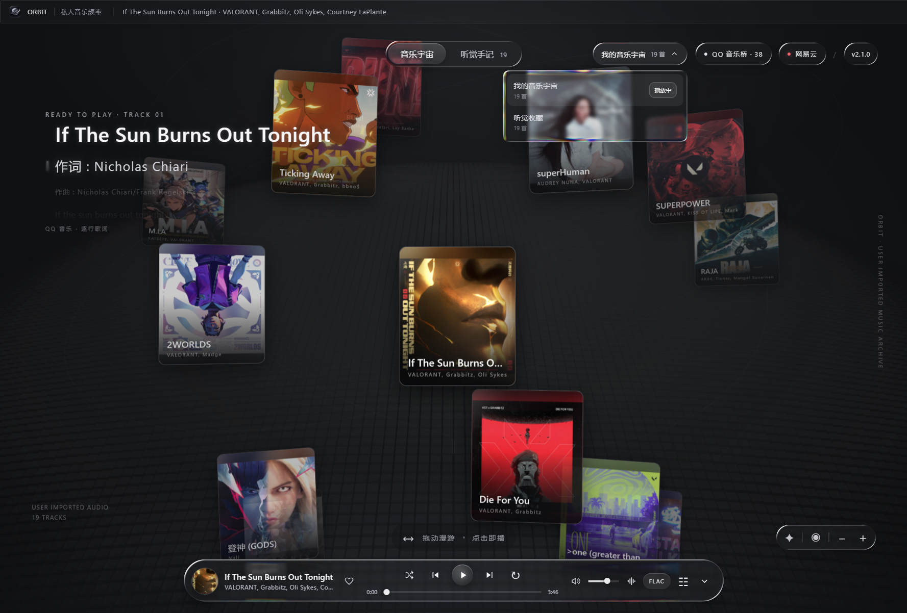
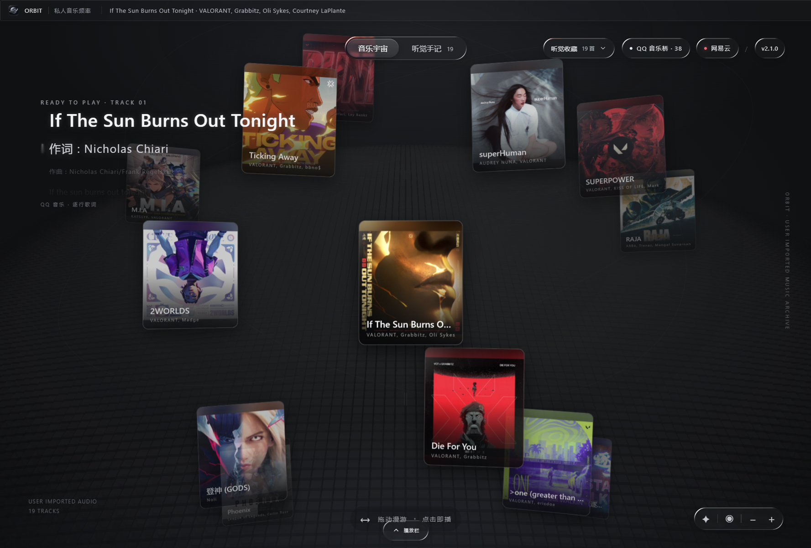

# ORBIT Music

在音乐宇宙里漫游的桌面播放器。使用 React、Electron、WebGL 声波地形与 Liquid DOM 液态玻璃，将歌单、歌词和实时律动放在同一个空间里。

**当前版本：2.1.3** · [下载 Windows 版](https://github.com/hb1234567898/aimusic/releases/latest) · [更新记录](CHANGELOG.md)

## 应用截图

截图使用项目中的示例曲目、真实封面与 LRC 展示界面；Windows 应用首次启动由用户自行导入歌单，不自动载入示例曲库。

### 音乐宇宙与液态玻璃播放栏



### 实时折射的歌单菜单



### 收起播放栏，保留音乐与律动



## 2.1.0 更新

- Windows 自定义标题栏，与音乐内容和顶部控件衔接。
- 底部播放栏、顶部胶囊和标题栏分别使用三档光学材质；歌单、音质、输出菜单及收起态播放栏统一接入玻璃效果。
- 支持完整动态背景的实时折射、边缘高光与轻微色散，音乐封面和声波地形延伸到顶部控件下方。
- 普通浏览器使用带柔和边线的 CSS 模糊回退；移动端继续采用轻量渲染。
- 调整较窄桌面窗口的顶部布局，菜单内容滚动时玻璃轮廓保持原位。
- 修复卡片超出窗口的问题；保留原有卡片大小并微调左右边距，上下尽量铺满窗口，可延伸到顶部按钮和底部播放栏后方。
- 球面布局随窗口和缩放自适应，拖动时保留安全边距；统一 Windows 任务栏、窗口与安装包图标。

## 开始使用

1. 从 [Releases](https://github.com/hb1234567898/aimusic/releases/latest) 下载 Windows x64 安装版、便携 EXE 或 ZIP 解压版。
2. ZIP 版须完整解压，保留 `resources`、`locales` 和 DLL 等文件，再运行 `ORBIT Music.exe`。
3. 打开 **QQ 音乐桥** 或 **网易云**，登录自己的账号，搜索歌曲或导入创建、收藏的歌单。QQ 音乐桥支持 QQ / 微信登录。
4. 每个歌单最多导入 **30 首**，通过顶部歌单菜单切换当前播放列表。

音源按当前账号权限获取，会员或地区限制以音乐平台返回结果为准。

## 功能

- 球面卡片拖动漫游、当前歌曲聚焦、暂停与切歌、随机及循环播放。
- 音量、播放进度与音频输出选择，断点续播和播放时保持屏幕常亮。
- 同步 LRC 歌词；QQ QRC / 网易云 YRC 提供有效逐字时间时使用真实逐字高亮，不生成估算歌词。
- WebGL 声波地形、音柱起伏与鼓点涟漪；移动端使用更轻量的背景。
- 播放栏收起 / 展开、歌单切换、听觉手记和 Windows 远程更新。

## 液态玻璃的运行条件

桌面端使用 [`@liquid-dom/core`](https://github.com/AndrewPrifer/liquid-dom) 的 WebGPU 渲染和 HTML-in-Canvas 实时背景纹理。Electron 已启用所需渲染功能；显卡或运行环境不支持时自动回退。

普通浏览器默认显示 CSS 回退效果，包含模糊、反光与半透明边线。真实背景折射需要浏览器同时支持 WebGPU 和 HTML-in-Canvas；仅使用 CSS 无法实现同样的像素位移。

## 本地开发

```powershell
npm install
npm run dev
```

访问 <http://127.0.0.1:8765/>。

桌面联调使用 `npm run dev:electron`。

```powershell
npm test
npm run build
```

网页构建产物位于 `dist/`。网页示例音频、封面及歌词位于 `public/assets/`；桌面应用使用用户导入的歌单。

## Windows 构建与发布

```powershell
npm run release
```

发布流程会构建安装版、便携 EXE 和 ZIP，并更新 GitHub Release 及远程更新清单。构建输出默认在 `%TEMP%\orbit-build`，可通过 `ORBIT_BUILD_OUTPUT` 指定其他工作区外目录。

请从工作区外的构建目录启动测试版。部分受限工作区会给其中的 EXE 继承 Low 完整性标签，导致安装包无法写入临时文件或应用启动即退出；不要将测试 EXE 复制回这样的目录运行。

## 第三方与曲目信息

- [第三方说明与许可证](THIRD_PARTY_NOTICES.md)
- [示例曲目来源](MUSIC_CREDITS.md) · [封面来源](COVER_SOURCES.md)

部分音乐桥登录逻辑参考 Sonic Topography，用于个人、非商业使用。请同时遵守第三方许可证和音乐平台使用条件。
